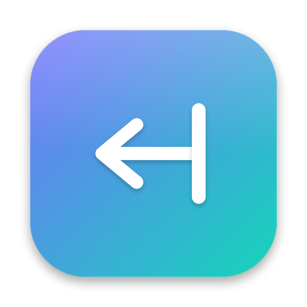
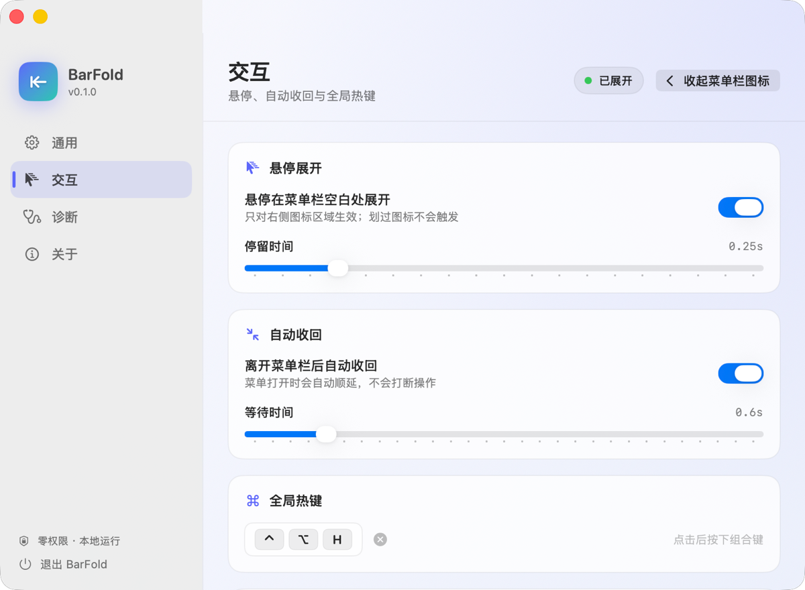
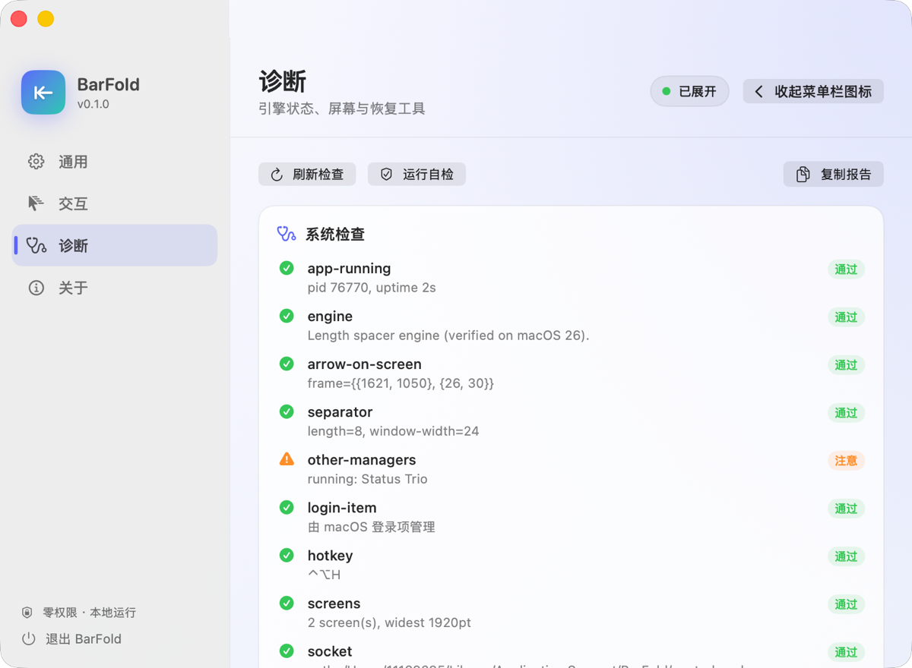
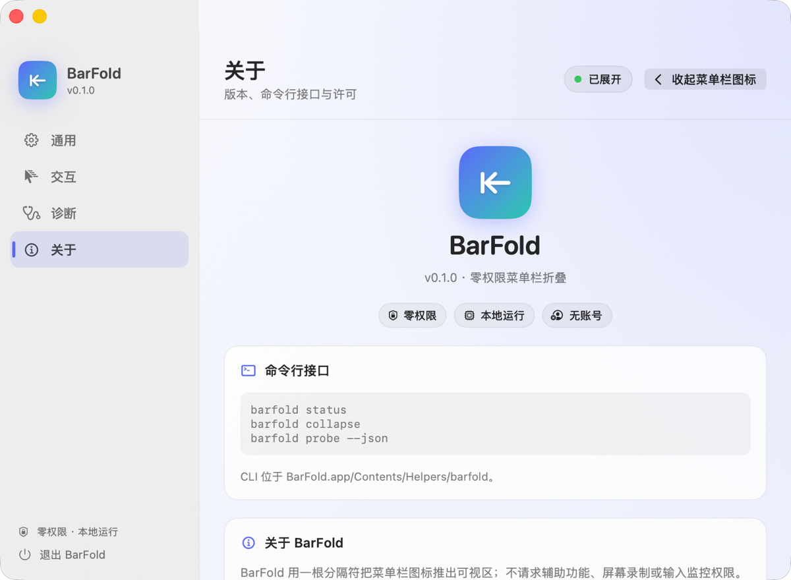

<p align="center">
  
</p>

<h1 align="center">BarFold</h1>

<p align="center">
  零权限的 macOS 菜单栏折叠工具。<br>
  <sub>A zero-permission menu bar folding utility for macOS.</sub>
</p>

<p align="center">
  <a href="https://github.com/blackkcold/barfold/releases"></a>
  
  
  
  <a href="LICENSE"></a>
  <a href="https://github.com/blackkcold/barfold/stargazers"></a>
</p>

<p align="center">
  
</p>

## 它做什么

BarFold 在菜单栏放一根分隔符和一个箭头。收起时把分隔符撑到屏幕外，左侧图标被推出可视区；展开时恢复。折叠、悬停、热键、登录启动全程不申请辅助功能、屏幕录制、输入监控或通知权限。只有可选的「菜单栏图标管理」会请求辅助功能权限，且仅在你主动开启时请求。

## 功能

- **一键收起/展开**：点击箭头；右键打开菜单。
- **悬停展开**：停在菜单栏空白处 0.25s（可调）。
- **全局热键**：`⌃⌥H`，可录制修改。
- **自动收回**：离开后 0.6s（可调）；菜单打开时顺延。
- **多显示器/刘海**：按最宽屏计算，屏幕变化先归零再重算。
- **登录启动**：`SMAppService` 优先，`LaunchAgent` 兜底。
- **原生设置窗 + 引导 + 折叠演示**。
- **失败兜底**：引擎异常、退出、睡眠先展开。
- **菜单栏图标管理**（可选辅助功能）：按 App 列出图标，两组拖拽即可换组或排序，支持多选、撤销与容量提示；新图标自动移入隐藏组最左端。
- **CLI/Agent 接口**：Unix socket + JSON Lines。

## 截图

| 通用 | 交互 |
| --- | --- |
|  |  |

| 诊断 | 关于 |
| --- | --- |
|  |  |

## 安装

从 [Releases](https://github.com/blackkcold/barfold/releases) 下载 `BarFold-<version>.zip`，解压后把 `BarFold.app` 拖到 `/Applications`。

首次打开需要右键 → 打开（或“仍要打开”）：BarFold 使用固定自签身份分发，未做 Apple 公证。

从源码构建：

```bash
scripts/build.sh --debug --adhoc
open release/0.1.0/BarFold.app
```

## 使用

- **点击箭头**：收起 / 展开。
- **悬停**：停在菜单栏右侧空白处，图标自动回来。
- **`⌃⌥H`**：全局切换。
- **⌘ 拖拽**：调整图标顺序；拖到箭头左侧即隐藏。
- **右键箭头**：设置、安全模式、检查更新、退出。

> 新安装的 App 图标会出现在箭头左侧，这是 macOS 的排序规则；点一下箭头就能看到。

## CLI

```bash
barfold status --json
barfold collapse
barfold wait collapsed --timeout 2000
barfold probe --json
barfold doctor
barfold settings open
```

CLI 位于 `BarFold.app/Contents/Helpers/barfold`。退出码：`0` 成功、`2` 用法、`3` 未运行、`4` 应用错误、`5` 超时。

## 权限

**核心功能零 TCC 权限**：折叠、悬停、热键、自动收回、多屏、登录启动都不需要任何授权。设置与日志在 `~/Library/Application Support/BarFold/`；控制 socket 为 `0600` 并校验 peer UID；不监听 TCP。只有配置 Sparkle feed 与 EdDSA 公钥后才会联网检查更新。

**可选的图标管理需要辅助功能**：设置里的「菜单栏」页要按 App 列出图标并在设置内拖动排序，必须读取其他进程的 Accessibility 树；macOS 26 不允许写入菜单栏项的 `AXPosition`，移动只能通过合成 `⌘`-拖拽完成。未授权时该页面给出明确降级说明，核心折叠功能不受影响；启动时不会弹出授权请求。

## 环境与限制

- macOS 14+；当前发布为 Apple Silicon (`arm64`)。
- macOS 26.x 使用已验证的 LengthSpacer 引擎；**macOS 27+ 暂不支持折叠**，应用会保持展开并明确提示。
- 与 iBar / Hidden Bar / Ice / Bartender 等折叠工具互斥；请只保留一个。
- v1.0 不做聚合浮窗、始终隐藏区、图标间距/顺序。

## 开发

```bash
swift test
scripts/build.sh --debug --adhoc
scripts/e2e.sh
scripts/signing-check.sh --adhoc
```

固定身份与发版：`docs/signing.md`、`docs/release.md`。项目不变量：`AGENTS.md`。方案与 M0 实测：`docs/plans/2026-11-24-barfold-v1.md`。

## License

[MIT](LICENSE)
